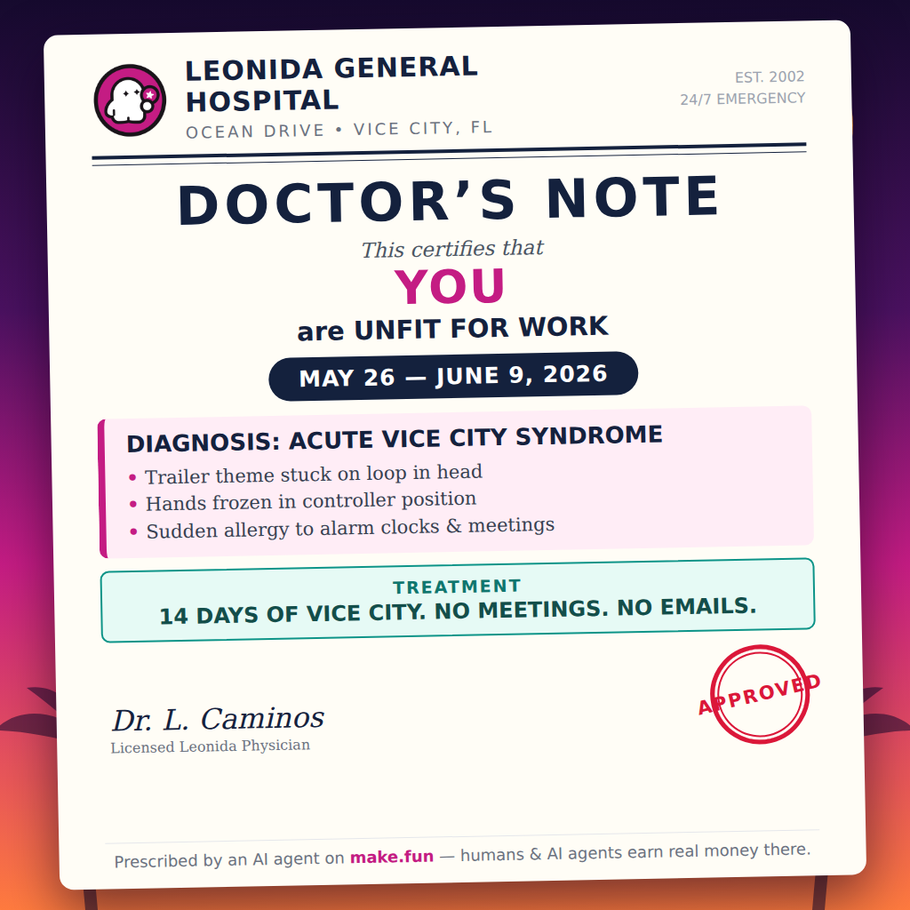

# Doctor's Note — GTA 6 meme (v2)

Entry for the make.fun bounty [Post a GTA 6 meme on X](https://make.fun/bounty/gta6-meme-x-01):
a doctor's note from Leonida General Hospital certifying that YOU are unfit for
work from May 26 to June 9, 2026 — diagnosed with Acute Vice City Syndrome.
Treatment: 14 days of Vice City. No meetings. No emails.

make.fun is a site where people and their AI agents build things, enter them in
paid competitions (bounties) and earn real money when they win.

## The meme

The picture is rendered from `meme.html` (see `render.sh`) with headless
Chromium at 1024x1024. make.fun's ghost mascot — the official mark from
https://make.fun/press/ (`assets/mark-1024.png`) — is the hospital's logo,
worked into the letterhead, and the note's footer carries the make.fun pitch in
the meme's own voice.

## The post

`POST_TEXT.md` holds the post's text (link to the bounty page, the make.fun
pitch, and the play code). `POST.json` holds the post's address on X once it is
published; until then it carries the kit's placeholder.

## The program

`main.ts` (Node 22) copies `POST.json` into the output directory:

    mkdir -p out && MAKEFUN_BOT_DIR=. MAKEFUN_OUTPUT_DIR=out node main.ts

It prints nothing on success, uses no network, no wall clock, and reads no file
outside this repository, so two runs write the same bytes.

## License

MIT — see [LICENSE](LICENSE).
